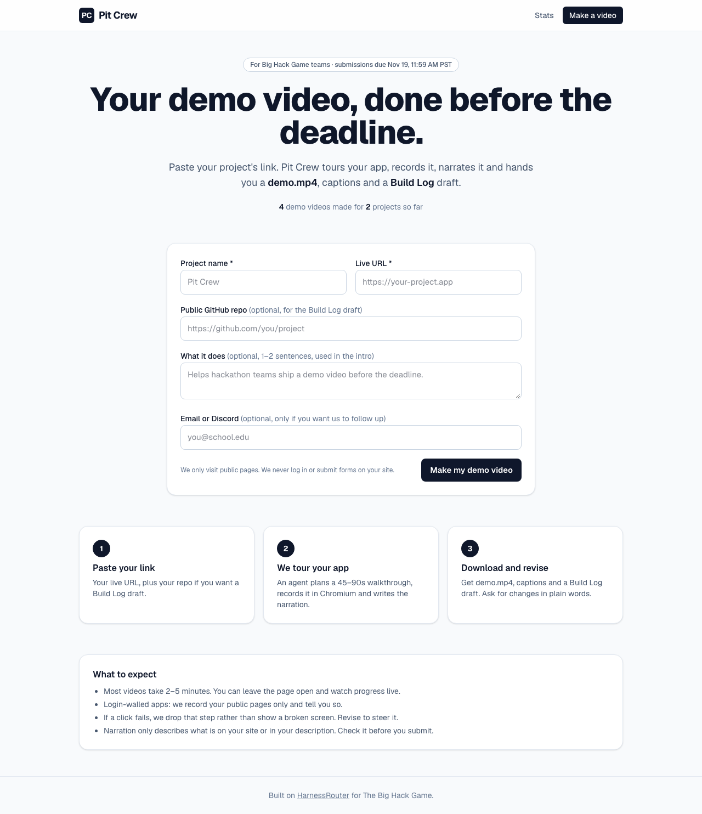
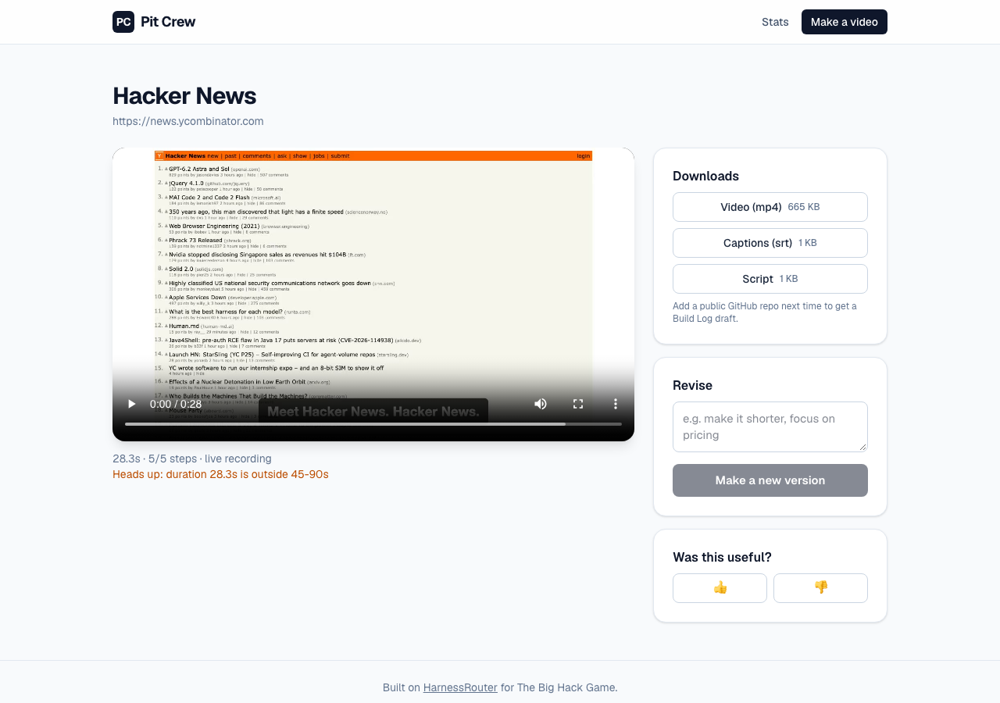

# Pit Crew

Paste your project's live link and get a narrated demo video (`demo.mp4`), captions, and a Build Log draft in a few minutes.

Built for The Big Hack Game (HarnessRouter, Stanford vs. Berkeley), where every team has to submit a demo video by the same deadline.

**Live demo:** _not deployed yet (see [HUMAN_TODO.md](HUMAN_TODO.md))_ · **Harness ID:** _pending_




## What it does

1. You paste a live URL (plus, optionally, a public GitHub repo and a one-line description).
2. Pit Crew opens the site in headless Chromium and collects a digest: headings, copy, internal pages, inputs.
3. A planner turns that into a click-flow (5–10 steps) with narration. In production, the planner is a **HarnessRouter agent**. Offline, it's a deterministic planner that only restates copy from the site.
4. The server records the flow with Playwright (with a visible cursor), voices the narration (OpenAI / ElevenLabs / Piper, or silent), and edits it with ffmpeg: title card, burned-in captions, end card.
5. You watch progress live (SSE), download the files, and can ask for a revision in plain words.

## Features

- Live progress: `Opening site → Planning flow → Recording → Writing narration → Voicing → Assembling`
- Outputs: `demo.mp4` (1280×720 H.264/AAC, faststart), `captions.srt`, `script.md`, `build_log.md`, `thumb.jpg`
- Revisions ("make it shorter", "focus on pricing"), continued in the same HarnessRouter session via `previous_response_id`
- Fallbacks instead of failures: failed steps are dropped, fewer than 3 good steps switches to a screenshot slideshow, TTS errors fall back to silence, an invalid agent plan falls back to the offline planner
- Guardrails: SSRF guard on the submitted URL and on every browser request, no logins or form submits, per-user/hourly/daily rate limits, 10-minute job timeout
- Public `/stats` from the database, `/admin?token=` with rerun, 👍/👎 feedback with opt-in quotes

## Tech stack

Next.js 16 (App Router, TypeScript) · Tailwind CSS 4 · SQLite (better-sqlite3) · Playwright/Chromium · ffmpeg · zod · Vitest · Docker (Railway)

## Architecture

```
Browser ──POST /api/jobs──► Next.js (one container)
   ▲                           │ in-process queue (MAX_CONCURRENT_JOBS)
   │ SSE /api/jobs/:id/events  ▼
   └──────────────── pipeline: explore ─► plan ─► record ─► voice ─► assemble
                                  │        │
                                  │        └─► HarnessRouter POST /v1/responses   (HARNESS_MODE=real)
                                  │            metadata.harness_id, stream, previous_response_id
                                  ▼
                       SQLite /data/pitcrew.db  +  /data/jobs/<id>/v<n>/ files
```

The agent does the thinking (flow JSON, narration, build log). Our server does the mechanics (Chromium, TTS, ffmpeg). This is "Plan B" in [SPEC.md](SPEC.md); the reasoning is in [DECISIONS.md](DECISIONS.md). HarnessRouter API notes: [docs/hr-api.md](docs/hr-api.md).

## Run locally

Requires Node 20+ and ffmpeg on your PATH.

```bash
npm install
npx playwright install chromium
cp .env.example .env          # defaults run fully offline (HARNESS_MODE=mock, TTS_PROVIDER=none)
npm run dev                   # http://localhost:3000
```

Production build: `npm run build && npm start`. Docker: `docker build -t pit-crew . && docker run -p 3000:3000 -v pitcrew-data:/data --env-file .env pit-crew`.

One job without the web app: `npx tsx scripts/run-local.ts https://example.com "Example"`.

## Environment variables

| Variable | Purpose |
|---|---|
| `HARNESS_MODE` | `mock` (offline planner, default) or `real` (HarnessRouter) |
| `HARNESSROUTER_BASE_URL`, `HARNESSROUTER_API_KEY`, `HARNESS_ID`, `HARNESS_MODEL` | HarnessRouter connection; the Harness ID is how usage is counted |
| `TTS_PROVIDER`, `TTS_API_KEY`, `TTS_VOICE` | `openai`, `elevenlabs`, `piper` or `none` (silent, captions only) |
| `ADMIN_TOKEN` | Protects `/admin` |
| `MAX_JOBS_PER_HOUR`, `MAX_JOBS_PER_USER_PER_DAY`, `MAX_JOBS_PER_DAY`, `MAX_CONCURRENT_JOBS` | Rate limits and budget cap |
| `DATA_DIR` | SQLite + job files (`/data` in Docker) |

## Tests

```bash
npm test          # 50+ tests: schemas, recorder (fixture site), TTS (mocked), assembly, SSRF, DB/stats, rate limits, API end to end
npm run lint && npm run typecheck
npx tsx scripts/eval.ts      # runs the pipeline on eval/sites.txt and writes eval/results.md
```

## Project structure

```
harness/schemas/      zod contracts: flow, script, output contract
harness/scripts/      record_flow, tts (+providers), assemble, slideshow, render (cards/captions), ff
src/lib/              explore (site digest), planner/local, harness/ (local + HarnessRouter clients),
                      pipeline, runner (queue + events), db, ssrf, ratelimit, validate
src/app/              pages (/, /jobs/[id], /stats, /admin) and API routes
scripts/              run-local, eval, hr-smoke (HarnessRouter smoke + sandbox probe), start
tests/                vitest suites + fixture site
```

## Current limits (honest)

- **Not yet verified against a live HarnessRouter server.** The client follows the UHP 2026-10-19 spec, but no API key was available while building. Until then, the app runs on the offline planner.
- The offline planner is good on content-rich marketing sites (Tailwind CSS: 60s, 8/8 steps) and weak on app-style pages with little copy, where videos come out at 24–35s, below the 45s target. Baseline: [eval/results.md](eval/results.md).
- Voice quality depends on the TTS key. Without one, videos are silent with burned-in captions.
- Single instance by design (in-process queue + SQLite). Fine for a hackathon's load, not for scale.

## What I learned

- Look at the output, not just the test result: two of the worst bugs (an unstyled title card from a quote inside a `style` attribute, and narration made of CSS class names) passed every automated check.
- Bundlers rewrite functions you pass to `page.evaluate` (esbuild's `__name` helper), so browser-side code should be a string.
- `new URL()` normalises `[::ffff:127.0.0.1]` to `[::ffff:7f00:1]`. An SSRF check has to handle the normalised form.

## Future improvements

- Run the eval on real Big Hack Game projects with the HarnessRouter planner and fix the top failure causes
- Let the agent repair a failed selector once before a step is dropped
- Regenerate demo videos automatically on each release (the post-hackathon use case)
